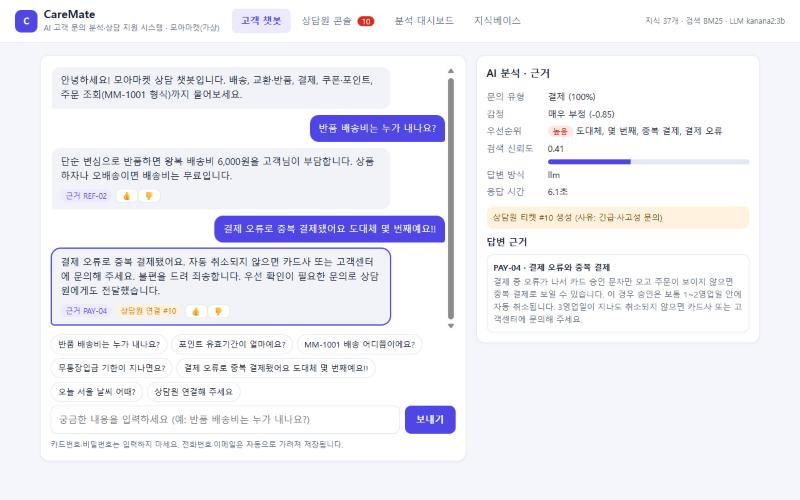
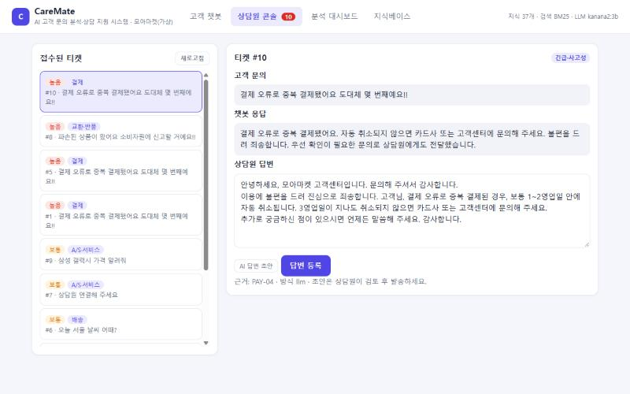
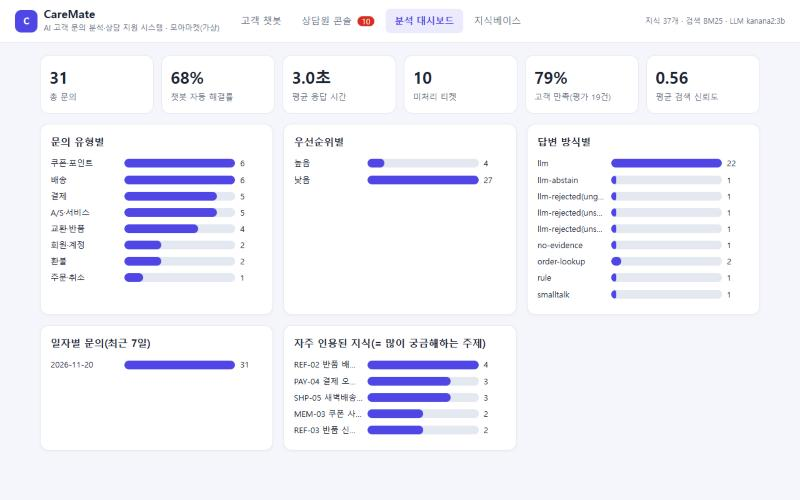

# CareMate 최종 프로젝트 결과보고서

인공지능 응용 시스템 개발 종합 프로젝트 · 작성일 2026-11-20 · 작성자 반재영 (개인 프로젝트)

## 1. 프로젝트 요약

CareMate는 가상 쇼핑몰 '모아마켓'의 고객 문의에 **안내 문서를 근거로 답하는 RAG 챗봇**과, 모든 문의를 **유형·감정·우선순위로 분석해 상담원에게 연결하는 상담 지원 시스템**입니다.
핵심 설계 원칙은 "모르면 지어내지 말고 사람에게 넘긴다"입니다. 이를 위해 검색 신뢰도 임계값, LLM의 '근거 부족' 응답, 숫자·근거 일치도 검사 세 겹의 장치를 두었습니다.

| 구분 | 결과 |
|---|---|
| 구현 기능 | RAG 챗봇, 주문 조회, 문의 분석, 개인정보 마스킹, 상담원 콘솔(AI 초안), 대시보드, 지식베이스 검색, 피드백 |
| 지식베이스 | 6개 문서 37개 항목(배송·교환반품·결제·회원·주문·서비스) |
| 자동 테스트 | 30개 모두 통과 |
| 검색 정확도 | hit@1 92.1%, hit@4 100% (질문 38개) |
| 답변 정확도 | 문구 자동 판정 81.4%, 개발자 수기 검토 90.7% (43개) |
| 응답 시간 | 중앙값 2.3초 (LLM 사용, 로컬 환경) |

## 2. 개발 배경과 목표

반복 질문은 문서로 자동 응대하고, 사람이 필요한 문의(결제 오류·파손·분실·법적 언급)는 우선순위를 붙여 빠르게 넘기는 것이 목표입니다. 일반 LLM은 문서에 없는 정책을 지어낼 수 있으므로, 근거 표시와 환각 방지를 필수 요건으로 삼았습니다.

## 3. 시스템 구성

```
브라우저 → Node.js REST 서버 → ChatService
  ① PII 마스킹 → ② 분석(분류·감정·우선순위) → ③ 분기(상담원요청·잡담·주문조회·RAG)
  ④ BM25 검색 → ⑤ Ollama LLM 생성 → ⑥ 환각 방지 검사 → ⑦ 답변 또는 상담원 티켓
SQLite(orders, inquiries, tickets), knowledge/*.md
```

| 파일 | 역할 |
|---|---|
| `src/rag.mjs` | BM25 검색, 신뢰도 계산, (선택) 임베딩 하이브리드 |
| `src/llm.mjs` | Ollama 호출, 환각 방지 검사, 추출형 답변 |
| `src/chat.mjs` | 질문 처리 흐름, 에스컬레이션, 상담원 답변 초안 |
| `src/analyze.mjs` | 나이브 베이즈 분류기, 감정·우선순위 규칙 |
| `src/db.mjs` | SQLite 스키마·질의·통계 |
| `server.mjs`, `public/` | REST API, 웹 화면 |
| `tools/eval.mjs` | 평가 도구(검색·답변·분류) |

## 4. 핵심 구현 내용

### 4.1 한국어 검색
형태소 분석기 없이 어절을 조사 제거 후 문자 바이그램으로 쪼개 BM25로 점수를 매깁니다. "반품을/반품은/반품하려면"처럼 활용이 달라도 같은 바이그램을 공유하기 때문에 별도 사전 없이 동작합니다. 질문의 군말("알려줘", "어때")은 검색 근거에서 제외합니다.

### 4.2 신뢰도와 에스컬레이션
신뢰도 = (질문 토큰 가중 커버리지) × (1 − 0.7 × 코퍼스 밖 어절 비율). 0.2 미만이면 LLM을 호출하지 않고 "자료를 찾지 못했다"고 답한 뒤 티켓을 만듭니다.

### 4.3 환각 방지 검사
LLM 답변이 다음을 통과해야 사용합니다.
1. 답변의 모든 숫자(금액·기간)가 참고 문서나 질문에 존재할 것
2. 인용 번호가 검색된 문서 범위 안일 것
3. 답변 바이그램 중 참고 문서에 있는 비율(근거 일치도)이 0.5 이상일 것 (질문 문구는 근거로 치지 않음)

최종 평가의 정상 LLM 답변 37개는 최저 0.57(대부분 0.7 이상)이었고, LLM이 문서에 없는 날씨를 지어낸 답변은 0.20~0.27이어서 임계값 0.5로 분리했습니다. 정상 답변 최저값과 임계값의 간격이 작아(0.57 대 0.5) 표현이 짧거나 다른 답변은 정상이어도 폐기될 수 있습니다(실제로 1건 발생). 검사 실패 시 검색 신뢰도가 0.6 이상이면 원문 발췌로 대체하고, 아니면 상담원에게 넘깁니다.
개발 중 이 검사의 필요성이 드러났습니다. 첫 평가에서 LLM이 "오늘 서울은 흐리고 가끔 비가 내릴 예정입니다"라고 답했는데 숫자가 없어 숫자 검사를 통과했고, 질문의 단어를 근거로 인정하던 초기 근거 일치도 검사도 통과했습니다. 질문 문구를 근거에서 제외하도록 고쳐 이 사례를 차단했습니다.

### 4.4 문의 분석
- **유형 분류**: 문자 바이그램 다항 나이브 베이즈(8개 유형, 학습 64문장).
- **감정·우선순위**: 부정·긴급·법적 표현·사고성 표현(중복 결제, 파손, 분실 등) 사전 점수. 근거가 된 단어를 상담원에게 함께 표시.
- **개인정보**: 전화번호·이메일·카드번호·주민번호를 정규식으로 가린 뒤 저장하고 LLM에도 가린 문장만 전달.

### 4.4-1 출처 표시
LLM이 붙인 [n] 인용 번호는 틀릴 수 있습니다(예: 배송비 답변에 반품 배송비 문서를 인용). 그래서 화면의 출처는 모델의 인용이 아니라 **답변 문장의 바이그램을 가장 많이 담은 문서**로 정했습니다. 이 변경으로 출처 일치율이 92.1%에서 97.4%로 올랐습니다.

### 4.5 상담원 지원
긴급 문의는 챗봇이 답한 뒤에도 별도 티켓이 만들어지며 우선순위순으로 정렬됩니다. '초안 생성'은 같은 RAG 파이프라인으로 근거가 달린 답변과 사과·인사 문구를 만들어 상담원이 검토 후 등록합니다. 근거가 없으면 "[상담원 작성 필요]"로 표시해 빈 답을 만들지 않습니다.

## 5. 실행 결과(화면)

| 고객 챗봇 + AI 분석·근거 | 상담원 콘솔 |
|---|---|
|  |  |



## 6. 테스트와 평가

측정일 2026-11-20, 로컬 Ollama `kanana2:3b`, 검색 방식 BM25. 원자료는 `evidence/rag-eval-llm.json`.

### 6.1 자동 테스트
`npm test` 30개 통과. 텍스트 처리, 검색, 분류, 환각 방지, 챗봇 흐름(근거 있음/없음, 주문 조회, 상담원 요청, PII 마스킹, 긴급 문의, 후속 질문, 잡담, 입력 검증, 프롬프트 주입 시도), 저장소(피드백, 중복 답변 방지, 초안, 통계)를 검증합니다.

### 6.2 RAG 평가 (질문 43개: 범위 안 38, 범위 밖 5)
| 지표 | 결과 |
|---|---|
| 검색 hit@1 | 92.1% (35/38) |
| 검색 hit@4 | 100% (38/38) |
| 범위 안 질문 수락 | 100% |
| 범위 밖 질문 — 검색 단계만 | 60% 거절 (3/5) |
| 범위 밖 질문 — 전체 파이프라인(LLM 검사 포함) | 5/5 상담원 연결 또는 잡담 응답 |
| 답변 정확도 — 핵심 문구 자동 판정 | 81.4% (35/43) |
| 답변 정확도 — 개발자 수기 검토 | 90.7% (39/43) |
| 출처로 표시된 문서가 정답 문서와 일치 | 97.4% (37/38) |
| 응답 시간 | 중앙값 2.3초, 최댓값 18.9초(1건) |
| 답변 방식 | LLM 37, 환각 검사에서 폐기 2, 근거 없음 3, 잡담 1 |

**수기 검토에서 결함으로 본 4건**: ① "환불은 며칠?" 카드 환불 기간을 문서보다 뭉뚱그려 설명, ② "무이자 할부는 몇 개월까지?"에 "6개월"만 답해 3개월 조건 누락, ③ "품절 시 환불?"은 근거 일치도 검사에서 폐기되어 상담원 연결(안전하지만 불필요한 연결), ④ "카드번호를 입력해도 되나요?"는 결론은 맞지만 문서에 없는 부연 설명 추가.
문구 판정에서는 틀렸으나 수기 검토에서 정답으로 본 경우는 5건입니다(예: "재고가 없으면" → "환불 처리됩니다").

### 6.3 문의 분류
학습과 분리한 24문장에서 **75.0%**(18/24). 오분류는 "주문 후 주소를 잘못 적었어요"(배송↔주문·취소)처럼 두 유형에 걸친 문장이 대부분입니다. 학습 데이터가 64문장뿐이라 확대가 필요합니다.

## 7. 한계와 정직한 평가

1. **평가 세트가 작고 편향될 수 있음**: 지식베이스와 평가 질문을 같은 사람이 썼습니다. 실제 고객의 표현(오타, 비문, 여러 질문 혼합)에서는 정확도가 낮아질 가능성이 큽니다.
2. **가상 문서**: 실제 기업 문서가 아닙니다. 긴 문서, 표, 모순되는 규정이 있는 환경은 검증하지 않았습니다.
3. **임베딩 검색은 검증하지 못함**: 하이브리드(BM25+임베딩) 코드를 구현했으나 이 PC의 Ollama `embeddinggemma`가 실행 중 비정상 종료(오류 코드 0xc0000409)되어 평가에 포함하지 못했습니다. 모든 수치는 BM25 기준입니다.
4. **검색 단계의 범위 밖 판별이 약함**: 어휘만으로는 "서울 날씨"처럼 일부 단어가 문서에 겹치는 질문을 걸러내지 못합니다(60%). LLM 단계의 근거 일치도 검사가 보완하므로 **LLM 없이 추출형 모드로 운영하면 범위 밖 질문에 관련 없는 문서가 노출될 수 있습니다.**
5. **소형 LLM의 한계**: 3B 모델은 같은 설정에서도 문장이 잘리거나 조건을 빠뜨릴 수 있습니다(수기 검토 4건). 환각 방지 검사는 숫자와 어휘 일치만 보므로 의미가 반대인 답변(예: "가능"↔"불가")은 걸러내지 못합니다.
6. **주문 조회는 데모**: 로그인·본인 인증 없이 주문번호만으로 조회합니다. 실제 서비스에서는 인증이 필수입니다.
7. **규모·보안**: 사용자 인증, 동시 접속 부하, 대량 로그 처리, 개인정보 보관 정책은 구현하지 않았습니다. 감정·우선순위 사전은 단순 규칙이라 반어법을 이해하지 못합니다.
8. **실사용자 검증 없음**: 만족도, 상담 시간 단축 등은 측정하지 않았습니다. 대시보드의 만족도 수치는 시연용 데이터입니다.

## 8. 향후 개선
- 실제 고객 문의 수집 후 평가 세트 확대, 한국어 형태소 분석기·임베딩 재순위화 도입 후 성능 비교
- 더 큰 모델 또는 인용 문장 단위 근거 검증(NLI)으로 의미 반대 답변 차단
- 상담원 수정 내용을 학습 데이터로 활용(분류기·초안 개선), 지식베이스 편집·업로드 화면
- 인증·권한, 로그 보관 정책, 부하 테스트

## 9. 결론
소규모 지식베이스에서 근거 표시, 환각 차단, 상담원 연결을 갖춘 RAG 상담 시스템을 구현하고 실행·평가했습니다. 검색은 안정적이었고(hit@4 100%), 소형 LLM의 오류는 검사와 에스컬레이션으로 일부 걸러냈으나 완전하지 않습니다. 수치는 자체 작성한 작은 평가 세트의 결과이며 실제 현장 성능을 보장하지 않습니다.


## 10. 원격 재현성 및 추가 검증 (2026-11-26)

기존 1~9절은 2026-11-20에 측정한 역사적 기록이다. 이번에는 누락된 두 JSON을 재구성하고 Linux/Node.js 24에서 GitHub Actions로 재검증했다. 기존 학습·평가 문장 원본 및 답변 문구 판정 기준은 확보하지 못했으므로 과거 수치와 직접 비교하지 않는다.

| 항목 | 재구성 데이터 검증 결과 |
|---|---|
| 단위 테스트 | 30/30 통과, 6개 스위트 |
| API·보안 검사 | 33/33 통과 |
| 검색 hit@1 / hit@4 | 35/38 (92.1%) / 38/38 (100%) |
| 분류 | 22/24 (91.7%) |
| 실행 환경 | Ubuntu, Node.js 24, LLM·임베딩 비활성 |
| Ollama 실모델 재평가 | 미실시 |

[실행 로그](https://github.com/mycom0216/caremate/actions/runs/45734441591) · [검증 기록](CI_VERIFICATION_2026-11-26.md) · [데이터 복구 기록](DATA_RECONSTRUCTION.md).

첫 CI 실행의 테스트 경로 오류를 수정한 후 모든 검증 단계가 성공했다. 기존 비즈니스 로직은 바꾸지 않았다. 이 검증은 Claude 로컬의 미커밋 주석·문서 및 실모델 결과를 포함하지 않으며, 실서비스 수준의 보안 검증을 의미하지 않는다.
