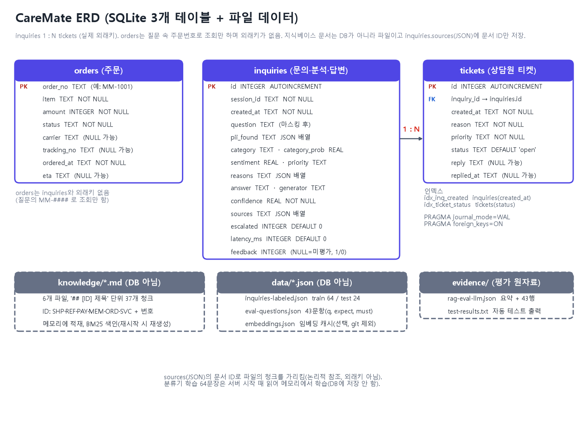

# CareMate 데이터정의서

작성일 2026-11-26 · 작성자 반재영 · 버전 1.0 · DBMS: SQLite(Node.js 내장 `node:sqlite`) · 구현: `src/db.mjs`(스키마·질의), `src/kb.mjs`(지식베이스 읽기)

## 1. ERD

- 실제 외래키는 `tickets.inquiry_id → inquiries.id` **하나**입니다(1 문의 : N 티켓 구조지만 현재 코드는 문의 1건에 티켓을 최대 1개 만듭니다). `PRAGMA foreign_keys = ON`으로 강제합니다.
- `orders`는 외래키가 없습니다. 질문 속 주문번호(`MM-####`)로 조회만 하며 문의 행에는 주문번호가 따로 저장되지 않습니다(주문번호는 질문 본문과 `sources` 안의 `id`로만 남음).
- **DB가 아닌 데이터**가 있습니다. 지식베이스(마크다운 6개 파일)는 서버 시작 때 메모리로 읽어 청크로 나누고 BM25 색인을 만듭니다. `inquiries.sources`(JSON)에는 문서 ID만 저장되어 파일의 청크를 가리킵니다(논리적 참조이며 DB 외래키가 아님).
- 이 DB에는 **CHECK 제약이 없습니다**. 우선순위·상태·유형 같은 값의 범위는 DB가 아니라 애플리케이션 코드가 지킵니다(「5. 데이터 관리 정책」 참조).

## 2. 테이블 목록

| 테이블 | 설명 | 주요 관계 |
|---|---|---|
| orders | 가상 주문(시연용 5건, 서버가 처음 열 때 비어 있으면 넣음) | 없음(주문번호로 조회) |
| inquiries | 고객 문의 1건 = 질문(마스킹본) + 분석 결과 + 챗봇 답변 + 근거 + 피드백 | 1:N tickets |
| tickets | 상담원에게 넘긴 문의의 처리 상태·답변 | N:1 inquiries |

## 3. 테이블 정의

### 3.1 orders
| 컬럼 | 타입 | 키 | NULL | 설명 |
|---|---|---|---|---|
| order_no | TEXT | PK | N | 주문번호 `MM-1001` 형식 |
| item | TEXT | | N | 상품명 |
| amount | INTEGER | | N | 금액(원) |
| status | TEXT | | N | 결제완료 · 상품준비중 · 출고완료 · 배송중 · 배송완료 |
| carrier | TEXT | | Y | 택배사(출고 전에는 NULL) |
| tracking_no | TEXT | | Y | 운송장 번호(출고 전에는 NULL) |
| ordered_at | TEXT | | N | 주문일 YYYY-MM-DD |
| eta | TEXT | | Y | 도착 예정일 YYYY-MM-DD |

시드 데이터(`SEED_ORDERS`): MM-1001 무선 이어폰 모아버즈 59,000원 배송중 · MM-1002 순면 후드티(M) 39,000원 상품준비중 · MM-1003 프리미엄 원두 1kg 28,000원 배송완료 · MM-1004 스테인리스 텀블러 21,000원 결제완료 · MM-1005 무선 청소기 189,000원 출고완료. 모두 직접 만든 가상 데이터입니다.

### 3.2 inquiries
| 컬럼 | 타입 | 키 | NULL | 설명 |
|---|---|---|---|---|
| id | INTEGER | PK(자동증가) | N | 문의 번호 |
| session_id | TEXT | | N | 브라우저 세션 ID(`web-` + 난수 UUID, 서버는 영문·숫자·`_`·`-` 6~64자만 허용). 후속 질문의 이전 대화를 찾는 데 사용 |
| created_at | TEXT | | N | 접수 시각(ISO 8601, UTC) |
| question | TEXT | | N | 고객 질문. **개인정보 마스킹 후**의 문장(원문은 저장하지 않음) |
| pii_found | TEXT | | N | 감지된 개인정보 종류의 JSON 배열(기본 `[]`). 값: 주민등록번호 · 카드번호 · 전화번호 · 이메일 |
| category | TEXT | | N | 문의 유형(분류기 결과): 배송 · 교환·반품 · 환불 · 결제 · 회원·계정 · 쿠폰·포인트 · 주문·취소 · A/S·서비스 |
| category_prob | REAL | | N | 분류 확률(0~1, 소수 셋째 자리) |
| sentiment | REAL | | N | 감정 점수(−1~0, 0에 가까울수록 중립) |
| priority | TEXT | | N | 우선순위: `high` · `medium` · `low` |
| reasons | TEXT | | N | 우선순위의 근거가 된 단어의 JSON 배열(기본 `[]`) |
| answer | TEXT | | N | 고객에게 보여 준 답변(긴급 문의는 사과 문구 포함) |
| generator | TEXT | | N | 답변 생성 방식. `llm` · `extractive` · `extractive(guard:사유)` · `order-lookup` · `smalltalk` · `rule` · `no-evidence` · `llm-abstain` · `llm-rejected(사유)` |
| confidence | REAL | | N | 검색 신뢰도(0~1). 주문 조회·잡담은 1, 상담원 요청은 0 |
| sources | TEXT | | N | 근거의 JSON 배열(기본 `[]`). 항목: `{kind: kb 또는 order, id, title, doc, text, score}` (주문 조회는 `kind=order`, `id`=주문번호) |
| escalated | INTEGER | | N | 상담원 티켓 생성 여부 0/1(기본 0). **긴급 문의를 챗봇이 답한 경우에도 1** |
| latency_ms | INTEGER | | N | 처리 시간(ms, 기본 0) |
| feedback | INTEGER | | Y | 고객 평가: NULL 미평가 · 1 도움이 됨 · 0 도움이 안 됨 |

### 3.3 tickets
| 컬럼 | 타입 | 키 | NULL | 설명 |
|---|---|---|---|---|
| id | INTEGER | PK(자동증가) | N | 티켓 번호 |
| inquiry_id | INTEGER | FK→inquiries.id | N | 원 문의 |
| created_at | TEXT | | N | 생성 시각(ISO 8601, UTC) |
| reason | TEXT | | N | 사유: `low_confidence`(근거 부족) · `user_request`(고객 요청) · `priority`(긴급·사고성) |
| priority | TEXT | | N | `high` · `medium` · `low`. 사유가 priority면 high, 아니면 문의 우선순위(low는 medium으로 올림) |
| status | TEXT | | N | `open`(기본) · `resolved` |
| reply | TEXT | | Y | 상담원 답변(5~2000자) |
| replied_at | TEXT | | Y | 답변 등록 시각 |

## 4. 인덱스

| 인덱스 | 대상 | 용도 |
|---|---|---|
| (자동) PK | orders(order_no), inquiries(id), tickets(id) | 기본키 조회 |
| idx_inq_created | inquiries(created_at) | 시간순 조회·일자별 집계 |
| idx_ticket_status | tickets(status) | 열린 티켓 목록·미처리 건수 |

`inquiries.session_id`(후속 질문 이력)와 `tickets.inquiry_id`에는 인덱스를 만들지 않았습니다. 현재 데이터 규모에서는 문제가 없지만 문의가 수만 건이 되면 추가가 필요합니다(측정하지 않음).

## 5. 데이터 관리 정책

| 항목 | 정책 |
|---|---|
| 개인정보 마스킹 | 주민등록번호 → 카드번호 → 전화번호 → 이메일 순으로 정규식 치환 후 저장·LLM 전달. **이름·주소·계좌번호·그 밖의 개인정보는 가리지 못함**(정규식 4종만) |
| 값의 범위 | DB에 CHECK 제약이 없으므로 priority·status·category 등은 코드가 정해진 값만 넣음. 다른 경로로 DB를 수정하면 범위 밖 값이 들어갈 수 있음 |
| 시간 표현 | 모두 UTC ISO 8601 문자열(`new Date().toISOString()`). 일자별 집계는 앞 10자(UTC 날짜) 기준이라 한국 시간 날짜와 다를 수 있음 |
| JSON 컬럼 | `pii_found`·`reasons`·`sources`는 TEXT에 JSON 문자열로 저장하고 조회 시 배열로 변환(DB 쿼리로 내부를 검색하지 않음) |
| 티켓 답변 원자성 | `UPDATE ... WHERE id=? AND status='open'`의 변경 행 수로 중복 답변 방지 |
| 동시성 | SQLite WAL 모드. 부하·동시 접속은 검증하지 않음 |
| 삭제·보존 | 삭제 기능 없음(보존 기간·삭제 정책 미구현). 로컬 파일 `data/caremate.db*`는 `.gitignore`로 git에서 제외 |
| 접근 통제 | 로그인·권한 없음. 문의·티켓·통계 API는 인증 없이 열려 있고 기본 127.0.0.1에서만 접속 가능 |
| 데이터 출처 | 주문·지식베이스·학습·평가 데이터 모두 직접 만든 가상 데이터. 실제 고객 데이터 없음 |

## 6. DB 밖의 데이터(파일)

### 6.1 지식베이스 `knowledge/*.md`
| 파일 | 문서 제목(첫 줄) | ID 접두어 | 청크 수 |
|---|---|---|---|
| shipping.md | 배송 안내 | SHP | 7 |
| refund.md | 교환·반품·환불 안내 | REF | 7 |
| payment.md | 결제 안내 | PAY | 6 |
| membership.md | 회원·포인트·쿠폰 안내 | MEM | 7 |
| order.md | 주문·취소 안내 | ORD | 5 |
| service.md | 고객센터·서비스 안내 | SVC | 5 |
| 합계 | 6개 파일 | | 37 |

형식: 첫 줄 `# 문서 제목`, 이후 `## [ID] 항목 제목` 아래에 본문. `kb.mjs`가 `## ` 단위로 쪼개 메모리의 청크 `{id, title, doc, file, text}`로 만들고, ID 형식(`[A-Z]+-숫자`)이 아닌 항목은 건너뜁니다. 서버를 다시 시작하면 색인이 다시 만들어집니다.

### 6.2 분류 학습·평가 `data/inquiries-labeled.json`
`{ "train": [[유형, 문장], ...], "test": [[유형, 문장], ...] }`. train 64문장(8개 유형 × 8), test 24문장(8개 유형 × 3). test는 학습에 쓰지 않는 분리 평가용입니다. 서버 시작 때 train으로 분류기를 메모리에서 학습하며 DB에 저장하지 않습니다.

### 6.3 RAG 평가 질문 `data/eval-questions.json`
`[{ "q": 질문, "expect": [정답 청크 ID], "must": [답변에 있어야 할 핵심 문구(하나 이상)] }, ...]` 43개. `expect`가 빈 배열인 5개는 범위 밖 질문(날씨·가격·주식·코딩·이름)으로, 이 경우 상담원 연결 또는 잡담 응답이 정답입니다.

### 6.4 임베딩 캐시 `data/embeddings.json` (선택)
`{ "key": SHA-256(모델명 + 청크 텍스트), "vectors": [[...], ...] }`. `EMBEDDINGS=on`일 때만 만들어지며 `.gitignore` 대상입니다. 이 PC에서는 임베딩 모델이 비정상 종료되어 **검증하지 못했습니다**(현재 저장소에 파일 없음).

### 6.5 평가 원자료 `evidence/`
| 파일 | 내용 |
|---|---|
| rag-eval-llm.json | `{at, summary, rows[43]}`. 행: q, expect, top4, confidence, inScope, accepted, hit1, hit4, correctDecision, retrieveMs, generator, answer, escalated, latencyMs, citedExpected, answerOk. 측정 2026-11-20, BM25 + kanana2:3b |
| test-results.txt | `node --test` 출력: 30 pass / 0 fail |

## 7. 코드 값 목록

| 구분 | 값 |
|---|---|
| 문의 유형(8) | 배송 · 교환·반품 · 환불 · 결제 · 회원·계정 · 쿠폰·포인트 · 주문·취소 · A/S·서비스 |
| 우선순위(3) | high 높음 · medium 보통 · low 낮음 (점수 ≥ 3 / ≥ 1 / 그 외) |
| 에스컬레이션 사유(3) | low_confidence · user_request · priority |
| 티켓 상태(2) | open · resolved |
| 감정 라벨(3) | 중립(0) · 부정(< 0) · 매우 부정(≤ −0.6) |
