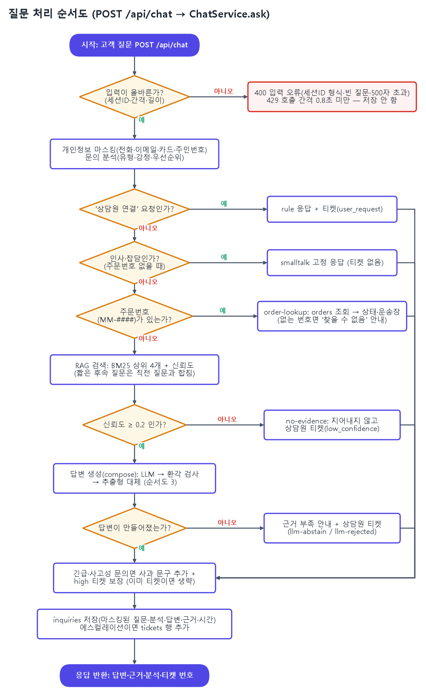

# CareMate 요구사항 분석서

작성일 2026-11-26 · 작성자 반재영 · 버전 1.0 · 인공지능 응용 시스템 개발 종합 프로젝트

## 목차
1. 개요 · 2. 시스템 범위와 이해관계자 · 3. 현황 분석과 문제 정의 · 4. 사용자 요구 분석 · 5. 기능 요구사항 분석 · 6. 비기능 요구사항 분석 · 7. 제약 사항과 가정 · 8. 유스케이스 · 9. 우선순위 · 10. 추적성 · 11. 위험 분석 · 12. 기존 문서와 코드의 차이

## 1. 개요

### 1.1 목적
가상 쇼핑몰 '모아마켓'의 고객 문의를 안내 문서를 근거로 자동 응대하고, 근거가 없거나 급한 문의는 분석해 상담원에게 넘기는 CareMate의 요구사항을 분석하고, 구현·시험의 기준으로 삼는다. 이 문서는 코드(`src/`, `server.mjs`, `public/`)와 평가 원자료(`evidence/`)를 직접 확인한 내용을 기준으로 작성했다.

### 1.2 시스템 개요
고객이 웹 챗봇에 질문하면 시스템이 ① 개인정보를 가리고 ② 문의 유형·감정·우선순위를 분석한 뒤 ③ 상담원 연결 요청·잡담·주문번호 조회·문서 검색(RAG)으로 분기한다. 문서 검색 경로는 BM25로 근거 문서 4개를 찾고, 로컬 LLM(Ollama, kanana2:3b)이 그 문서만 쓰도록 답을 만들고, 숫자·인용·근거 일치도 검사를 통과해야 답으로 쓴다. 통과하지 못하거나 근거가 없으면 지어내지 않고 상담원 티켓을 만든다. 상담원은 우선순위순 티켓과 근거가 달린 AI 답변 초안을 받고, 운영자는 대시보드로 문의 통계를 본다.

### 1.3 용어
| 용어 | 뜻 |
|---|---|
| RAG | 검색 증강 생성. 문서를 먼저 검색하고 그 내용만으로 답을 만드는 방식 |
| 청크 | 지식베이스 문서를 `## [ID] 제목` 단위로 나눈 한 항목(예: `REF-02 반품 배송비`). 현재 37개 |
| BM25 | 단어 빈도와 희소성으로 문서 점수를 매기는 검색 공식. 여기서는 단어 대신 문자 바이그램을 사용 |
| 바이그램 | 어절을 두 글자씩 겹쳐 자른 조각("반품" → 반품). 조사·어미가 바뀌어도 같은 조각이 남음 |
| 신뢰도 | 질문 토큰의 가중 커버리지 × (1 − 0.7 × 코퍼스 밖 어절 비율). 0~1 |
| 환각 | 문서에 없는 내용을 그럴듯하게 지어내는 LLM의 오류 |
| 근거 일치도 | 답변 바이그램 중 참고 문서에 있는 비율. 0.5 미만이면 폐기 |
| 에스컬레이션 | 챗봇이 못 풀거나 급한 문의를 상담원 티켓으로 넘기는 것 |
| 생성 방식(generator) | 답변을 만든 경로. llm · extractive · extractive(guard:사유) · order-lookup · smalltalk · rule · no-evidence · llm-abstain · llm-rejected(사유) |
| 추출형 답변 | LLM 없이 검색된 문서에서 질문과 겹치는 문장 최대 3개를 원문 그대로 보여 주는 방식 |
| PII | 개인식별정보(전화번호·이메일·카드번호·주민등록번호) |

## 2. 시스템 범위와 이해관계자

| 구분 | 내용 |
|---|---|
| 범위 안 | 문서 기반 답변과 출처 표시, 근거 부족·환각 방지, 주문번호 조회, 문의 유형·감정·우선순위 분석, 개인정보 마스킹, 상담원 콘솔(티켓·AI 초안·답변 등록), 대시보드, 지식베이스 조회·검색, 답변 피드백 |
| 범위 밖 | 로그인·권한·본인 인증, 실제 쇼핑몰·결제·배송사 연동, 다중 상담원 배정·SLA, 문서 편집·업로드 화면, 대량 접속 대응, 모바일 앱, 임베딩 검색의 정식 지원(코드는 있으나 이 PC에서 검증 못 함) |

| 이해관계자 | 관심사 |
|---|---|
| 고객 | 24시간 즉시 답, 주문 배송 상태 확인, 필요하면 사람 연결 |
| 상담원 | 급한 문의 먼저, 근거가 달린 답변 초안, 중복 답변 방지 |
| 운영자 | 문의 유형 분포·자동 해결률·자주 묻는 주제, 안내 문서 개선 |
| 개발자(본인) | 근거 있는 답변, 측정 가능한 품질, 유지보수 |
| 평가자(강사) | 요구사항–설계–시험의 일관성, 측정 결과의 정직성 |

## 3. 현황 분석과 문제 정의

| 현황 | 문제 | CareMate의 대응 |
|---|---|---|
| 문의 상당수가 배송비·반품 기간처럼 문서에 답이 있는 반복 질문 | 상담원이 같은 답을 반복 작성하는 동안 결제 오류·파손 같은 급한 문의가 밀림 | 문서 기반 자동 답변 + 긴급·사고성 문의는 별도 high 티켓 |
| 일반 LLM 챗봇 | 문서에 없는 정책을 그럴듯하게 지어냄(잘못된 환불 안내 → 분쟁) | 근거 문서만 사용하도록 지시 + 신뢰도·'근거 부족'·숫자·근거 일치도 3겹 검사, 실패하면 상담원 연결 |
| 한국어는 조사·어미 변화가 많음 | 형태소 분석기 없이는 검색이 흔들림 | 조사 제거 + 문자 바이그램 BM25 |
| 상담원은 고객의 감정·긴급도를 읽어야 함 | 목록이 시간순이면 급한 건이 묻힘 | 유형·감정·우선순위(근거 단어 포함) 자동 분석, 우선순위순 정렬 |
| 고객이 문의에 전화번호·카드번호를 적음 | 저장·외부 전달 위험 | 저장 전·LLM 전달 전 정규식 마스킹 |
| 운영자는 무엇이 많이 궁금한지 모름 | 안내 문서 개선 근거 부족 | 자주 인용된 지식 Top 5, 유형별 통계 |

## 4. 사용자 요구 분석

| ID | 사용자 요구 |
|---|---|
| UN-01 | (고객) 문서에 있는 내용은 바로, 출처와 함께 정확히 답해 주길 원한다 |
| UN-02 | (고객) 챗봇이 모르는 내용을 아는 척하지 않고 사람에게 연결해 주길 원한다 |
| UN-03 | (고객) 주문번호(MM-1001)로 배송 상태를 확인하고 싶다 |
| UN-04 | (고객) "그럼 배송비는요?" 같은 짧은 되묻기도 이해해 주길 원한다 |
| UN-05 | (고객) 직접 상담원과 연결해 달라고 하면 바로 접수되길 원한다 |
| UN-06 | (고객) 내가 적은 전화번호·카드번호가 그대로 저장되지 않길 원한다 |
| UN-07 | (상담원) 급한 문의를 우선순위순으로 보고, 왜 급한지 근거 단어를 알고 싶다 |
| UN-08 | (상담원) 근거가 달린 답변 초안을 받아 검토·수정만 하고 싶다 |
| UN-09 | (상담원) 같은 티켓에 두 번 답이 나가지 않길 원한다 |
| UN-10 | (운영자) 자동 해결률·응답 시간·만족도·자주 묻는 주제를 보고 싶다 |
| UN-11 | (모두) LLM 서버가 없어도 서비스가 멈추지 않길 원한다 |
| UN-12 | (평가자) 어떤 수치가 측정된 것이고 무엇이 측정되지 않았는지 알고 싶다 |

## 5. 기능 요구사항 분석

| 영역 | 요구 | 핵심 판단 |
|---|---|---|
| 검색 | 한국어 문서 검색 | 형태소 분석기 대신 조사 제거 + 문자 바이그램 BM25. 질문의 군말("알려줘", "어때")은 근거에서 제외. 문서 제목은 2배 가중 |
| 신뢰도 | 범위 밖 질문 판별 | 어휘 커버리지만으로는 "서울 날씨"처럼 일부 단어가 문서에 겹치는 질문을 못 거른다(검색 단계 5개 중 3개 거절) → 코퍼스 밖 어절 패널티 + LLM 단계 검사로 보완 |
| 생성 | 문서만 사용하는 답변 | 프롬프트로 제한 + temperature 0. 소형 3B 모델은 지시를 어길 수 있으므로 **코드로 검증** |
| 검증 | 환각 차단 | 숫자 ⊂ 문서·질문, 인용 번호 범위, 근거 일치도 ≥ 0.5(질문 문구는 근거로 안 침). 실패 시 신뢰도 0.6 이상이면 원문 발췌, 아니면 상담원 |
| 출처 | 신뢰할 수 있는 근거 표시 | 모델이 붙인 [n]은 틀릴 수 있어 쓰지 않고, 답변과 바이그램이 가장 많이 겹치는 문서를 출처로 표시 |
| 분석 | 유형·감정·우선순위 | 유형은 학습 데이터 64문장의 나이브 베이즈, 감정·우선순위는 사전 점수(근거 단어 반환) |
| 분기 | 처리 경로 | 상담원 요청 → 잡담 → 주문번호 → RAG 순. 주문번호가 있으면 잡담 규칙을 건너뜀 |
| 긴급 | 사고성·법적 언급 | 챗봇이 답했더라도 별도 high 티켓을 만들고 사과 문구를 덧붙임 |
| 상담원 | 초안·등록 | 같은 RAG 파이프라인으로 초안(신뢰도 0.15 이상일 때), 근거 없으면 "[상담원 작성 필요]". 등록은 `WHERE status='open'` 단일 UPDATE로 중복 방지 |
| 개인정보 | 마스킹 | 주민번호 → 카드 → 전화 → 이메일 순 정규식. 마스킹본만 저장·LLM 전달 |

## 6. 비기능 요구사항 분석

| 분류 | 요구 |
|---|---|
| 가용성 | LLM(Ollama)이 없거나 오류여도 추출형 답변으로 계속 동작 |
| 정직성·설명가능성 | 모든 답변에 근거 문서·생성 방식·신뢰도를 표시, 우선순위에는 근거 단어 표시, 평가의 한계를 문서에 명시 |
| 개인정보 | 저장 전 마스킹, 입력 금지 안내 문구, LLM에는 마스킹된 문장만 전달 |
| 보안 | 입력 500자·본문 20,000바이트 제한, 세션당 0.8초 간격 제한, 응답은 textContent로 출력(XSS), 상위 경로 접근 차단, 프롬프트 주입 무시 지시, 서버 오류는 일반 문구, 기본 127.0.0.1 바인딩 |
| 신뢰성 | 외래키 활성, 티켓 답변은 원자적 갱신, 문서 검색은 서버 시작 때 색인 |
| 성능 | 측정만 수행: 질문 43개 응답 중앙값 2.3초, 최댓값 18.9초(로컬 3B 모델). 목표 기준은 정하지 않음 |
| 이식성·유지보수 | Node.js 24 이상만 필요(외부 npm 패키지 0개), 자동 테스트 30개, 평가 도구(`tools/eval.mjs`) |
| 사용성 | 4개 탭(챗봇·상담원·대시보드·지식베이스), 860px 이하에서 한 열 배치. 375px 폭 확인 기록은 없음 |

## 7. 제약 사항과 가정

- 개인 프로젝트(1인), 기획서 12/04, 최종 발표 12/30. 외부 npm 패키지 없이 Node.js 24 내장 기능(`node:sqlite`, `node:test`)만 사용.
- 모아마켓과 안내 문서 37개 항목, 주문 5건, 분류 학습·평가 문장은 **직접 작성한 가상 데이터**다. 실제 고객 문의로 검증하지 않았다.
- 지식베이스와 평가 질문을 같은 사람이 작성해 정확도가 낙관적일 수 있다.
- LLM은 로컬 3B급(kanana2:3b)이다. 더 큰 모델·외부 API는 측정하지 못했다.
- 임베딩 검색(BM25+임베딩)은 코드가 있으나 이 PC에서 `embeddinggemma`가 비정상 종료되어 검증하지 못했다. 모든 수치는 BM25 기준이다.
- 만족도 지표는 시연용 데이터이며, 상담 시간 단축 효과 등은 측정하지 않았다.

## 8. 유스케이스

| ID | 유스케이스 | 주 흐름 | 예외 |
|---|---|---|---|
| UC-01 | 문서 기반 질문 | 질문 입력 → 답변 + 근거 문서 + 유형·감정·우선순위·신뢰도 표시 | 근거 부족 → 안내 + 티켓 생성 |
| UC-02 | 주문 조회 | 질문에 MM-1001 포함 → orders 조회 → 상태·운송장·도착 예정일 | 없는 번호 → "찾을 수 없음" 안내(티켓 없음) |
| UC-03 | 상담원 연결 요청 | "상담원 연결해 주세요" → 즉시 접수 안내 + 티켓(user_request) | – |
| UC-04 | 긴급 문의 | 결제 오류·파손 등 → 챗봇 답변 + 사과 + high 티켓 | – |
| UC-05 | 티켓 확인과 답변 | 우선순위순 목록 → 티켓 선택 → AI 초안 → 수정 → 등록 | 이미 처리됨 409, 길이 오류 400, 티켓 없음 404 |
| UC-06 | 운영 통계 확인 | 대시보드 탭 → KPI·유형별·우선순위별·답변 방식별·일자별·자주 인용된 지식 | 데이터 없음 안내 |
| UC-07 | 지식베이스 검색 | 검색어 입력 → 검색기 순서·점수 표시 | – |
| UC-08 | 답변 평가 | 👍/👎 클릭 → 저장·통계 반영 | 없는 문의 404 |

### 8.1 처리 순서도

(순서도 전체는 「CareMate 순서도」 문서 참조)

## 9. 요구사항 우선순위 (MoSCoW)

| 구분 | 요구사항 |
|---|---|
| Must | FR-01~06, 08, 10~12, NFR-01·02·03·04·05 |
| Should | FR-07, 09, 13~15, NFR-06·07·08 |
| Could | FR-16(상태 표시), FR-17(문의 목록 API), NFR-09 |
| Won't | 로그인·권한, 실제 쇼핑몰 연동, 문서 편집 화면, 부하 대응, 임베딩 검색의 정식 지원 |

## 10. 추적성

| 사용자 요구 | 기능 요구 | 설계 요소 | 시험·평가 |
|---|---|---|---|
| UN-01 | FR-01 | `kb.mjs`, `rag.mjs`, `llm.mjs` | 검색 적중률 테스트, eval(hit@1 92.1%, hit@4 100%) |
| UN-02 | FR-02·03 | 신뢰도 임계값, `guardAnswer` | 환각 방지 테스트 5개, 범위 밖 질문 5개 평가 |
| UN-03 | FR-04 | `describeOrder`, orders 테이블 | 주문 조회 테스트 3개 |
| UN-04 | FR-09 | `retrievalQuery` | 후속 질문 테스트 |
| UN-05 | FR-07 | `wantsHuman` | 상담원 연결 테스트 2개 |
| UN-06 | FR-06 | `maskPII` | 마스킹 테스트 2개 |
| UN-07 | FR-05·08·10 | `analyzeTone`, 티켓 정렬 | 분석 테스트, 사고성 문의 테스트 |
| UN-08 | FR-11 | `ChatService.draft` | 초안 테스트 |
| UN-09 | FR-12 | `replyTicket` 단일 UPDATE | 중복 처리 테스트 |
| UN-10 | FR-14 | `Store.stats` | 통계 테스트 |
| UN-11 | NFR-01 | `OllamaLLM.check`, `extractiveAnswer` | 모든 자동 테스트가 LLM 없이 실행 |
| UN-12 | NFR-05 | 결과보고서 한계 절, `evidence/` | 평가 원자료 보관 |

## 11. 위험 분석

| 위험 | 가능성 | 영향 | 대응 |
|---|---|---|---|
| 소형 LLM이 조건을 빠뜨리거나 부연을 지어냄 | 높음(수기 검토 43개 중 4개 결함) | 부정확한 안내 | 3겹 검사, 실패 시 원문 발췌·상담원 연결, 한계 명시 |
| 의미가 반대인 답변("가능"↔"불가")은 어휘 검사로 못 거름 | 중간 | 잘못된 안내 | 해결 못 함(한계). 향후 NLI·큰 모델 |
| 범위 밖 질문이 검색 단계를 통과 | 높음(검색 단계 거절 60%) | 관련 없는 문서 노출 | LLM 단계 근거 일치도 검사가 보완. **LLM 없이 운영하면 노출 가능** |
| 정상 답변이 검사에서 폐기(정상 최저 일치도 0.57 대 임계 0.5) | 중간(평가에서 1건) | 불필요한 상담원 연결 | 안전한 쪽으로 실패. 임계값은 평가 세트 기준이라 일반화 불확실 |
| 분류 정확도가 낮음 | 높음(분리 24문장 75.0%) | 유형 통계 왜곡 | 두 유형에 걸친 문장이 대부분. 학습 데이터 확대 필요 |
| 평가 세트가 작고 같은 사람이 작성 | 높음 | 정확도 과대평가 | 한계로 명시, 실제 문의 수집 후 재평가 |
| 인증 없는 주문 조회·콘솔 API | 높음(설계상) | 실제 서비스에서 개인정보 노출 | 데모 범위로 한정, 기본 127.0.0.1 바인딩 |
| 발표 환경에 LLM 미설치 | 중간 | 시연 품질 저하 | 추출형 자동 대체(범위 밖 질문 처리는 약해짐을 인지) |

## 12. 기존 문서와 코드의 차이

기획서(11/20)·결과보고서(11/20)·README를 코드와 대조한 결과, 이 문서 세트는 **코드를 기준**으로 작성했다. 확인된 차이는 다음과 같다(기존 문서는 수정하지 않았다).

| 항목 | 기존 문서 | 코드·원자료 기준 |
|---|---|---|
| DB 컬럼 | 기획서 4.3: orders에 `ordered_at` 없음, inquiries에 `created_at`·`pii_found` 없음, tickets에 `created_at` 없음 | 실제 스키마에는 모두 있음(「데이터정의서」 참조) |
| 개발 일정 | 기획서 7장: 문의 분석·콘솔·대시보드는 12/05~12/16 개발 예정 | 코드와 평가는 11/20 커밋에 이미 포함(이 문서 세트의 「개발일정표」는 실적 기준) |
| 호출 제한 | 기획서 "요청 속도 제한", `server.mjs` 주석 "세션당 1초에 1회" | 코드는 같은 세션의 직전 요청과 800ms 미만이면 429 |
| 모바일 | 기획서 3.3 "375px에서 가로 스크롤 없음" | 860px 이하 한 열 배치 CSS는 있으나 375px 확인 기록은 없음 |
| 수기 검토 90.7% | 결과보고서·README | 원자료(`evidence/rag-eval-llm.json`)에는 자동 판정(81.4%)만 있고 수기 판정 기록은 없음 |
| 근거 일치도 "정상 최저 0.57, 날씨 0.20~0.27" | 결과보고서 4.3 | 원자료 행에 일치도 값이 저장되어 있지 않아 이 문서 작성 중 재확인하지 못함(코드 주석에는 같은 값 기재) |
