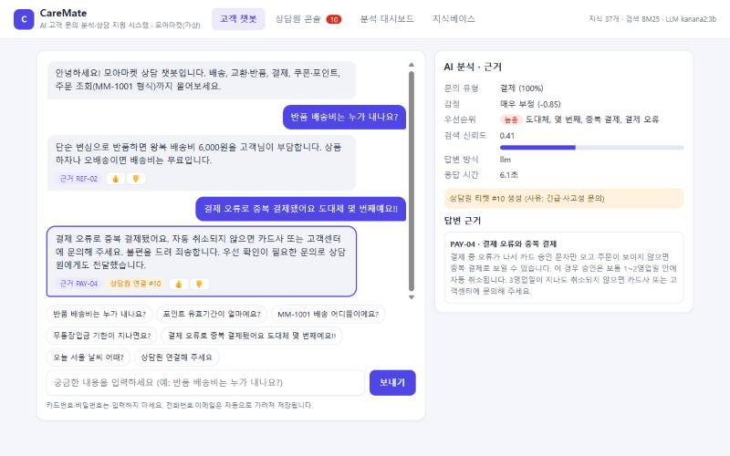
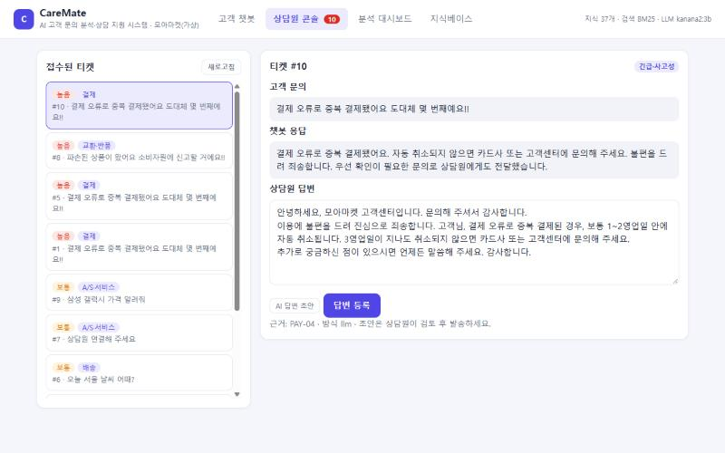
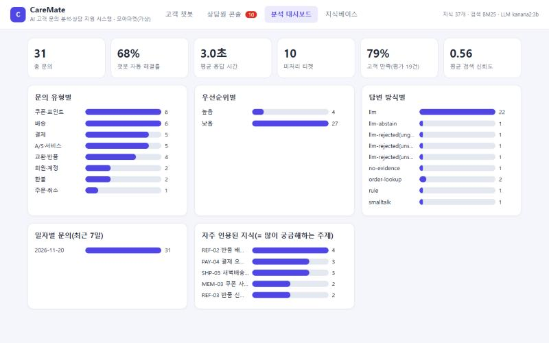
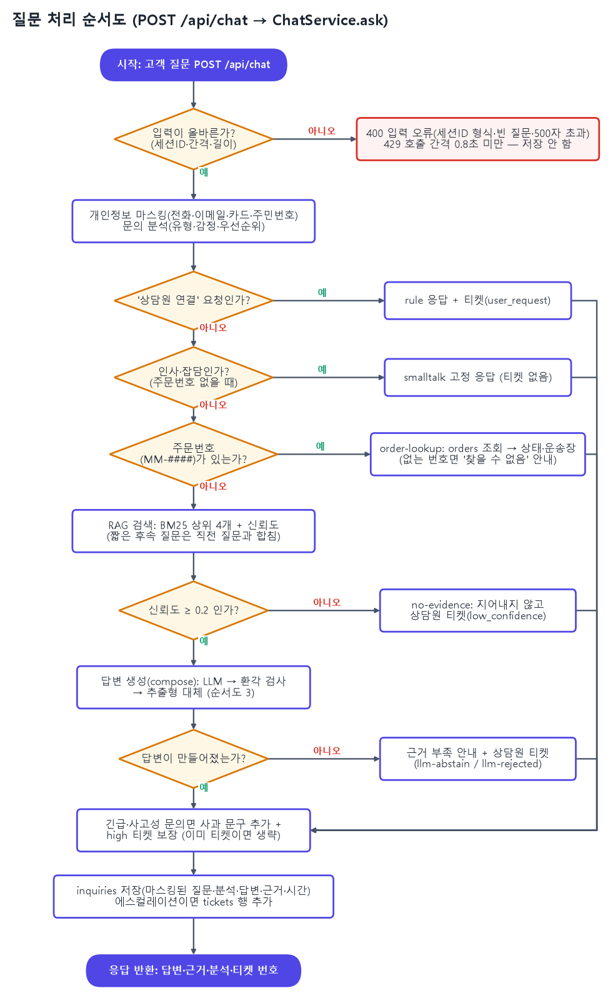
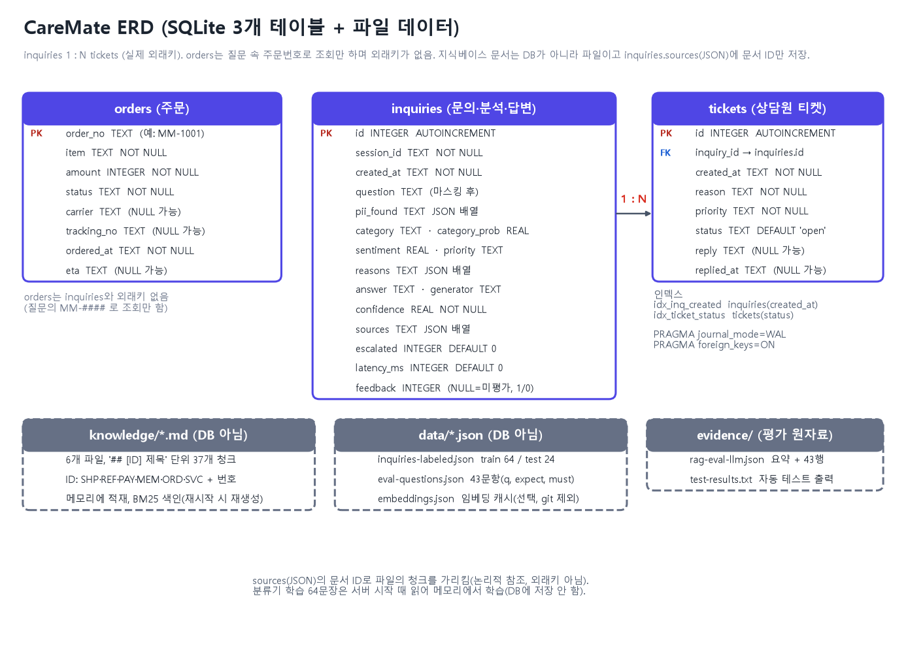

# 포트폴리오 — CareMate

## 한 줄 소개
쇼핑몰 고객 문의에 **안내 문서를 근거로** 답하고, 근거가 없거나 급한 문의는 **지어내지 않고 분석해서 상담원에게 넘기는** RAG 챗봇·상담 지원 시스템.

## 프로젝트 정보
| 항목 | 내용 |
|---|---|
| 작성자 | 반재영 (개인 프로젝트, 기획·설계·구현·평가·문서 전 과정) |
| 과정 | 인공지능 응용 시스템 개발 종합 프로젝트 |
| 일정 | 기획서 제출 2026-12-04, 최종 발표 2026-12-30 (핵심 기능과 1차 평가는 11/20 완료) |
| 기술 | Node.js 24, SQLite(`node:sqlite`), Ollama(kanana2:3b), BM25(문자 바이그램), 나이브 베이즈, 바닐라 JS, 외부 npm 패키지 0개 |
| 코드 | `projects/CareMate` — `src/` 약 680줄 + `server.mjs` 약 100줄 + `public/` 약 300줄, 자동 테스트 30개 |
| 데이터 | 가상 쇼핑몰 '모아마켓' — 안내 문서 6개 37항목, 주문 5건, 분류 학습 64·평가 24문장, 평가 질문 43개(모두 직접 작성한 가상 데이터) |

## 문제와 해결
- **문제**: 고객센터 문의의 상당수는 배송비·반품 기간처럼 문서에 답이 있는 반복 질문이라 상담원이 같은 답을 쓰는 동안 결제 오류·파손 같은 급한 문의가 밀린다. 그렇다고 LLM만 붙이면 문서에 없는 환불 정책을 그럴듯하게 지어낸다.
- **해결**: 문서를 검색해 **그 문서만으로** 답하게 하고, 답을 코드로 검증한다(검색 신뢰도 → LLM '근거 부족' 응답 → 숫자·인용·근거 일치도 검사). 통과하지 못하면 원문 발췌 또는 상담원 티켓. 모든 문의는 유형·감정·우선순위(근거 단어 포함)로 분석하고, 상담원에게는 근거가 달린 답변 초안을 준다.

## 핵심 결과
측정: 2026-11-20, 로컬 PC, Ollama `kanana2:3b`, 검색 BM25, 질문 43개(범위 안 38 + 범위 밖 5). 원자료 `evidence/rag-eval-llm.json`.

| 지표 | 결과 |
|---|---|
| 검색 정답 문서가 1위 / 상위 4개 안 | **92.1%** (35/38) / **100%** (38/38) |
| 답변 핵심 문구 자동 판정 | **81.4%** (35/43) — 개발자 수기 검토는 90.7%(39/43)로 결과보고서에 기록(원자료에는 자동 판정만 있음) |
| 출처로 표시된 문서가 정답 문서와 일치 | **97.4%** (37/38) |
| 범위 밖 질문 5개 | 검색 단계 거절 60%(3/5), **전체 파이프라인에서는 5/5 상담원 연결 또는 잡담 응답** |
| 문의 유형 분류(학습과 분리된 24문장) | **75.0%** (18/24) |
| 응답 시간(LLM 사용) | 중앙값 **2.3초**, 최댓값 18.9초(1건) |
| 자동 테스트 | **30개 모두 통과**(전부 LLM 없이 실행) |
| 답변 방식 분포 | LLM 37 · 환각 검사 폐기 2 · 근거 없음 3 · 잡담 1 |

- **지어내지 않는다**: "오늘 서울 날씨 어때?"에 LLM이 답을 만들었지만 근거 일치도 검사에서 폐기되어 상담원 연결로 끝났다(평가 원자료: `llm-rejected(ungrounded)`).
- **LLM 없이도 돈다**: Ollama가 없으면 검색된 문서의 문장을 원문 그대로 보여 주는 추출형으로 자동 전환.
- **개인정보를 저장하지 않는다**: 전화·이메일·카드·주민번호를 마스킹한 뒤에만 저장하고 LLM에도 가린 문장만 전달(테스트로 확인).

## 화면
시연용 데이터로 캡처한 화면입니다. 대시보드의 수치(문의 31건, 해결률 68%, 만족 79%)는 시연 데이터이며 실제 성능이 아닙니다.

| 고객 챗봇 (답변 + 근거 + AI 분석) | 상담원 콘솔 (우선순위 티켓 · AI 초안) |
|---|---|
|  |  |

## 아키텍처·데이터·흐름

구조 요약: 브라우저 → Node.js REST 서버 → `ChatService`(① 개인정보 마스킹 → ② 문의 분석 → ③ 분기: 상담원 요청·잡담·주문 조회·RAG → ④ BM25 검색 → ⑤ LLM 생성 → ⑥ 환각 방지 검사 → ⑦ 답변 또는 티켓) → SQLite 3테이블(orders·inquiries·tickets) + `knowledge/*.md`.

## 내가 한 기술적 선택과 이유
| 선택 | 이유 |
|---|---|
| 형태소 분석기 대신 조사 제거 + 문자 바이그램 BM25 | 외부 패키지 없이 "반품을/반품은/반품하려면"을 같은 조각으로 묶을 수 있다. 결과: hit@4 100% |
| 답변을 프롬프트에만 맡기지 않고 **코드로 검증** | 3B 모델은 지시를 어길 수 있다. 숫자·인용 번호·근거 일치도를 코드가 검사해 통과한 답만 사용 |
| 근거 일치도에서 **질문 문구를 근거로 치지 않음** | 질문을 되풀이하며 지어낸 답이 통과하는 것을 막기 위해 |
| 출처는 모델의 [n]이 아니라 **답변과 가장 많이 겹치는 문서** | 모델이 붙인 인용 번호가 틀리는 경우가 있어서(출처 일치율 92.1% → 97.4%) |
| 검증 실패 시 신뢰도 0.6 이상이면 원문 발췌, 아니면 상담원 | 관련 없는 문서를 답으로 내밀지 않기 위해 "안전한 쪽으로 실패" |
| 긴급·사고성 문의는 챗봇이 답해도 별도 high 티켓 | 중복 결제·파손은 자동 답변만으로 끝내면 안 된다 |
| 티켓 답변을 `WHERE status='open'` 단일 UPDATE로 | 확인과 갱신을 한 번에 해 두 상담원이 같은 티켓에 답하는 것을 막기 위해 |
| 외부 npm 0개, Node 내장 SQLite·테스트 러너 | 설치 부담 없이 실행·재현 가능 |

## 측정해서 발견하고 고친 것
(결과보고서·발표자료에 기록된 개발 이력이며, 현재 코드에 반영되어 있음을 확인함)
1. **날씨 답변이 검사를 통과**: LLM이 문서에 없는 날씨를 답했는데 숫자가 없어 숫자 검사를 통과하고, 질문 단어를 근거로 인정하던 초기 근거 일치도 검사도 통과 → 질문 문구를 근거에서 제외해 차단.
2. **출처가 틀림**: 모델이 배송비 답변에 반품 배송비 문서를 인용 → 답변 바이그램 기준 출처 선택(97.4%).
3. **"상담원이 답해 주나요?"를 연결 요청으로 오인** → '상담원' 단어만 보지 않고 연결·통화 같은 요청 동사와 함께일 때만 인정.
4. **정상 질문까지 범위 밖으로 판정** → 코퍼스 밖 어절 패널티를 3글자 이상 어절·선형으로 완화.
5. **분류 정확도를 부풀릴 뻔함** → 평가 문장과 비슷한 학습 문장을 추가했다가 폐기하고, 분리된 24문장으로만 평가(75.0%).

## 배운 점과 한계
- 검색이 잘 되는 것(hit@4 100%)과 범위 밖을 거르는 것(검색 단계 60%)은 다른 문제다. 어휘만으로는 "서울 날씨"처럼 단어 일부가 겹치는 질문을 못 거르고, LLM 단계의 검사가 보완한다. **LLM 없이(추출형) 운영하면 범위 밖 질문에 관련 없는 문서가 보일 수 있다.**
- 소형 LLM은 조건을 빠뜨린다(예: 무이자 할부 질문에 "6개월"만 답하고 3개월 조건 누락). 검사는 숫자·어휘만 보므로 "가능"↔"불가"처럼 **의미가 반대인 답은 못 거른다.**
- 정상 답변의 근거 일치도 최저값(0.57, 결과보고서 기록)과 임계값(0.5)의 간격이 작아, 표현이 다른 정상 답변이 폐기될 수 있다(평가에서 1건 — 안전한 쪽 실패).
- 평가 세트가 작고(43개) 문서와 질문을 같은 사람이 썼으며 데이터는 전부 가상이다. 실제 고객 표현(오타·여러 질문 혼합)에서는 낮아질 가능성이 크다.
- **측정하지 못한 것**: 임베딩(하이브리드) 검색(이 PC에서 모델이 비정상 종료), 실사용자 만족도·상담 시간 단축, 동시 접속 부하, 큰 모델과의 비교. 인증·권한·개인정보 보관 정책은 구현하지 않았다(주문 조회는 인증 없는 데모).
- 12월 계획: 다른 사람이 쓴 질문으로 평가 세트 확대, 분류 학습 데이터 확대, 임베딩 재시도.

## 산출물
기획서 · 요구사항 분석서 · 요구사항 명세서 · 데이터정의서(ERD) · 순서도 4종 · 개발일정표 · 결과보고서 · 발표자료(PPTX·PDF) · 소스 코드 · 자동 테스트 30개 · 평가 원자료(`evidence/`)
